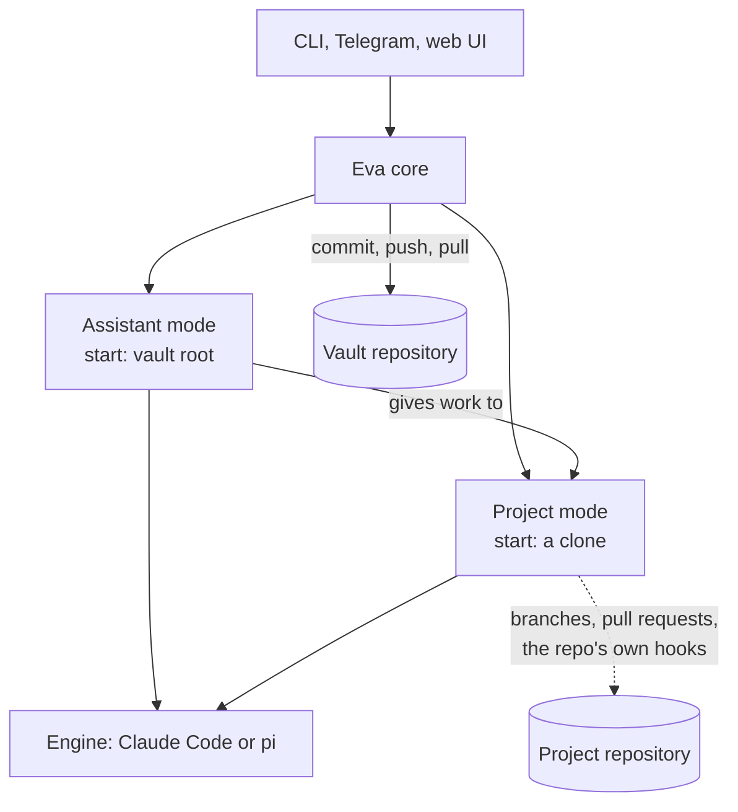

# Eva plan

Eva is a personal "super harness". She is one service that runs AI coding agents over a person's knowledge vault and projects, and she shows them in a terminal, Telegram, and a web app.

The name comes from EVE, the clever robot in the film WALL-E. Eva is the mind. A physical robot body can come one day, under its own name. Write `Eva` in prose and `eva` in identifiers. Eva takes the pronoun "she". The previous system is called Wall-I v1.

This plan says what Eva does and why. `intent.md` records what the owner wants. `lessons-from-v1.md` records what Wall-I v1 learned. `review-2026-10-14.md` records the reviews and the owner's answers. `spikes.md` records the results of the small real tests. The plan must satisfy all of them.

**Status: approved by the owner on 2026-10-14,** with the instruction to implement it autonomously. Draft 3 adds the final review round (`review-2026-10-14.md`, "Final round").

## 1. Decisions

| #   | Decision                                                                                                                                                         | Why                                                                                                                                   |
| --- | ---------------------------------------------------------------------------------------------------------------------------------------------------------------- | ------------------------------------------------------------------------------------------------------------------------------------- |
| D1  | Two repositories: the public engine `guplem/eva`, and one private vault for each person (`guplem/vault`)                                                         | The vault autosaves to `main`. The engine needs pull requests and CI. Sharing needs an engine with no personal data.                  |
| D2  | The engine is developed as a public project from the first commit, and becomes public when CI with the leak checks is green (§13)                                | Anybody can read it. No personal data, ever.                                                                                          |
| D3  | Knowledge folders sit at the vault root                                                                                                                          | The vault holds only knowledge now.                                                                                                   |
| D4  | A project is a folder `Projects/YYYY-MM-DD-HHmm-name/` with YAML front matter in its `AGENTS.md`                                                                 | Ids never collide and show the order. One file serves people, machines and agents.                                                    |
| D5  | Cloned repositories live in `Projects/<project>/repos/<repo>-<n>/`, ignored by the vault's git                                                                   | Each clone is one parallel workspace.                                                                                                 |
| D6  | Eva is one core process per instance. The CLI, Telegram and the web UI are its front ends                                                                        | Easy to run, lives on a Linux server, reachable from any device. One process owns the vault (lesson 20).                              |
| D7  | Eva owns vault sync inside her own code. Eva has no agent hooks, and the vault has no agent hooks                                                                | Each harness has its own hook system. Behaviour that Eva needs belongs to Eva.                                                        |
| D8  | Two modes. **Assistant mode** is Eva's own behaviour. **Project mode** is a transparent wrapper: it behaves exactly as opening the clone in the selected harness | The owner wants project work to be identical to opening the folder in Claude Code.                                                    |
| D9  | Claude Code is the main engine, connected directly through the Claude Agent SDK. pi is supported, connected directly. More engines come later                    | Claude Code is what the owner pays for, and a direct link keeps forks (spike S2). pi is the fallback if the Claude subscription ends. |
| D10 | Remote access through Tailscale only                                                                                                                             | The web UI gives full shell access to the machine.                                                                                    |
| D11 | Any number of instances can run, under one OS user or several                                                                                                    | Each instance has its own home folder, port and vault. Isolation between instances is the user's responsibility.                      |
| D12 | TypeScript, run with Bun                                                                                                                                         | One language for core and UI. The Agent SDK, pi and ACP ship TypeScript libraries.                                                    |
| D13 | One conversation list for each instance, shown by every front end                                                                                                | A chat started in Telegram continues in the web app, and back.                                                                        |
| D14 | A person's settings live in the vault (`.eva/settings.json`); a machine's settings and all secrets stay in the instance home (owner, 2026-10-17)                 | Every machine with the vault uses the same settings, with no copy to keep in step.                                                    |
| D15 | Eva updates herself at a frequency in the settings, only when no chat runs, then restarts (owner, 2026-10-17)                                                    | A server install stays current with no SSH session.                                                                                   |

## 2. Repositories

### 2.1 Engine: `guplem/eva`

- The core source, tests, CI, and docs.
- The base assistant prompt (§5.2).
- A link to the vault template repository (§11).
- **Never** personal data: no vault content, no names of private people, no machine addresses, no employer names, no tokens, no absolute home paths.
- No merge ruleset for now. CI runs on every pull request and locally (§13).

### 2.2 Vault: `guplem/vault` (private)

```
vault/
  .eva/                   marks the vault root; Eva's vault-side files
    assistant.md          the person's assistant rules; Assistant mode only
    schedules.json        schedule definitions (lesson 64)
    .claude-plugin/       makes .eva/ a local plugin, loaded in Assistant mode only
    skills/               assistant-only skills (the plugin's skills)
  AGENTS.md               the vault map: where each kind of note goes
  .agents/skills/         skills for every session in the vault
  .pskill/                programmatic skills (config: hook_files: [])
  Principles/ Methods/ Toolbox/ Library/ Life/ _to sort/
  Projects/
    2025-03-02-1015-example-app/
      AGENTS.md           front matter (§3.2) + what an agent must know about the project
      ...notes...
      repos/              ignored by git (D5)
        example-app-0/
  Scratch/                ignored by git: files made only to send, files received
```

- **No `CLAUDE.md` anywhere in the vault.** A `CLAUDE.md` in a folder stops Claude Code from reading every `AGENTS.md` (lesson 112, confirmed by spike S3).
- **No agent hooks in the vault.** The vault's pskill config sets `hook_files: []`, so `pskill sync` writes no hooks.
- **`AGENTS.md` at the root stays small and neutral:** a map of where things go. Personal rules go in `.eva/assistant.md`.
- **`.eva/skills/` is not in any folder that an engine searches by itself.** Eva passes `.eva/` as a local plugin in Assistant mode only (SDK `plugins` option). Spike S3 confirmed that `.eva/skills/` stays out of project sessions.

## 3. Projects

### 3.1 Folder name

`YYYY-MM-DD-HHmm-name`, for example `2025-03-02-1015-example-app`.

- **The timestamp is always the creation time,** to the minute, in the instance's time zone. An idea gets a folder too, with `status: idea`, so the id never changes.
- **An unknown time gets the closest estimate,** found from every source. The front matter records the precision.
- **`name` is lowercase with hyphens.**
- **Nobody types the id.** The `new-project` pskill generates it.

### 3.2 Front matter

```yaml
---
created: 2025-03-02T10:15 # required; matches the folder id
created_precision: minute # minute | day | month | year
status: active # required: idea | active | paused | closed
started: 2025-03-03
closed:
objective: One sentence that says when the project is done.
deadline:
repos:
  - https://github.com/owner/example-app
drive: # created only when files must be shared
legacy_id: P93 # matches the Drive folder "P## - Name"
tags: [work]
---
```

- **Required:** `created` and `status`. Every other field is optional.
- **Unknown keys are kept.** An invalid field shows a warning badge; it never breaks the list (lesson 54).
- **No `@` imports** (lesson 8).
- **A Drive folder is created only on request.**

### 3.3 Discovery and search

- **The vault root** is the nearest folder with `.eva/`.
- **Projects** are the folders under the vault's `Projects/` whose `AGENTS.md` has the front matter. Extra project roots can be added in the config.
- **Search and filters** in every front end: by name, status and tags, most recent first. Telegram `/projects`, CLI `eva projects`.

### 3.4 Clones

- **`repos/<repo>-<n>/`,** where `<n>` counts from 0.
- **"New clone"** clones into the next free `<n>`. Eva also creates a clone by herself when a task needs a free one: a clone is free when no session runs in it and its working tree is clean.
- **Vault sync never enters a clone** (lesson 19).

### 3.5 Migration of existing projects (phase P1)

The inventory is done: 155 projects, confirmed by the owner on 2026-10-14 (rules in `review-2026-10-14.md`, "Project groupings"). P1 first copies the confirmed list into the vault (`Projects/_inventory.csv`), then creates one folder for each project, moves the existing notes, and writes the front matter. The Sheet becomes read-only history.

## 4. The core

### 4.1 Responsibilities

| Area           | What Eva does                                                                                   |
| -------------- | ----------------------------------------------------------------------------------------------- |
| **Vault sync** | Commit, push and pull the vault (§6)                                                            |
| **Projects**   | Find, search and filter projects; create clones; show the branch and pull request of each clone |
| **Sessions**   | Start, resume, fork, retry and stop engine sessions; keep the index (§4.5)                      |
| **Skill runs** | Keep pskill runs going without hooks (§5.4)                                                     |
| **Approvals**  | Relay permission requests to a front end (§5.5)                                                 |
| **Schedules**  | Fire scheduled messages, on the hub instance only (§9)                                          |
| **Front ends** | Local API, CLI, Telegram, web UI                                                                |
| **Settings**   | Config and secrets in the instance home, with a test for each one                               |

### 4.2 Layers

```
src/
  shared/        types, errors, the event union, seams (clock, process runner, logger)
  core/          instance, vault sync, projects, sessions, skill runs, approvals, schedules
  engines/       claude-code/, pi/   (adapters; implement the engine port)
  frontends/     api/ (HTTP + WebSocket), cli/, telegram/, web/
  main.ts        wiring only
```

- **Import rules,** enforced by `dependency-cruiser` in CI: `shared` imports nothing of ours. `core` imports only `shared`. `engines/*` import only `shared`. `frontends/*` import `shared` and the core's public API, never `engines`. Only `main.ts` wires everything.
- **A front end never names an engine** (v1 ADR `0003`).

### 4.3 Process model

- **One core process for each instance.** It holds `<home>/eva.lock`. A second start exits with code 3.
- **A stale lock never blocks a start.** The lock holds the pid and, on Linux, the boot id. Eva takes over a lock whose process no longer runs, or a lock from an earlier boot.
- **A stop always ends.** Eva gives her front ends and the core 20 seconds to stop, then releases the lock and exits.
- **The core serves a local API** on its port: HTTP for commands, WebSocket for events. `eva chat`, `eva status`, the web UI and other tools are clients of this API. Telegram runs inside the core.
- **The API checks `Host` and `Origin`** on every request and every WebSocket upgrade, and requires a token (§12).
- **Exit codes** (lesson 89): `0` clean stop, `1` crash, `2` bad config, `3` second instance (never retried), `4` restart for an update. The systemd unit sets `RestartPreventExitStatus=2 3`.

### 4.4 Instances and the home folder

- **Home folder:** `--home <path>` or `EVA_HOME`. Default: `$XDG_CONFIG_HOME/eva` (Linux, else `~/.config/eva`), `%APPDATA%\eva` (Windows).
- **Layout:**
  - `config.json`: this machine's settings, checked against a schema: the vault folder, the machine name, the port, the project roots, program paths, Telegram, remote host names, `remoteAccess.tailscaleServe`
  - The person's settings live in the vault, in `.eva/settings.json` (D14): the time zone, updates, the vault fetch and save intervals, the default engine and model, pi's models, trust, Google, the voice language, the allowed Tailscale identities. The vault file wins over `config.json`. At start, Eva pulls the vault, then moves these keys out of an older `config.json`; when the vault already has the file, the vault wins. A broken vault file never stops Eva: she logs it and keeps `config.json`.
  - `secrets.json`: tokens, readable by the OS user only
  - `state/sessions.json`, `state/trust.json`, `state/schedules-state.json`, `state/telegram.json`
  - `logs/eva-YYYY-MM-DD.jsonl`, kept for 14 days
  - `engines/claude/`, `engines/pi/`, `engines/gh/` (used only by extra instances, see below)
- **Writes are atomic** (a temporary file, then a rename). A bad file never crashes Eva (lesson 54).
- **Port:** default 7420. `eva setup` picks the next free port for each new instance. A rerun of setup keeps the port of the instance that runs with this home.
- **Engine config folders:** the first instance of an OS user uses the user's own `~/.claude`, pi and `gh` folders, so Project mode sees the same user settings, skills and history as a manual session (D8). Each extra instance on the same OS user sets `CLAUDE_CONFIG_DIR`, pi's agent folder and `GH_CONFIG_DIR` to its `engines/` folders, so two people never share a login (lesson 111). An instance is extra when its home folder is not the platform default. Eva sets `CLAUDE_CONFIG_DIR` and `GH_CONFIG_DIR` by herself; pi's agent folder waits for a documented pi variable. The `engines.claudeCode.ownConfigFolder` setting also gives the default home its own Claude folder.
- **Roles:** `hub` or `satellite`, with no setting (ADR 0012). The vault names its hub in `.eva/hub.json`: the first machine that starts with the vault claims it, after a pull. `eva hub` or the web UI moves it; the old hub notices at its next vault fetch and stops Telegram and the schedules without a restart. The hub runs Telegram whenever it has a bot token. Without a vault, a machine is its own hub. A satellite (for example a PC with a vault clone) syncs the vault and serves its own CLI and web UI.
- **Plug and play:** each machine setting has a default that Eva finds on the machine: the vault folder (`<home>/vault`), the voice model (`<home>/voice/ggml-base.bin`), the machine name (the host name), the remote host name (`tailscale status`), the program paths (`PATH`), and a free port at setup. `eva service install` names the service `eva` for the default home and `eva-<folder>` for any other, so two instances never share one service.

### 4.5 Sessions, forks and retry

- **Session record** (`state/sessions.json`): `id`, `engineSessionId`, `engine`, `mode`, `modelAlias`, `startFolder`, `projectId?`, `clone?`, `parentId?`, `forkAtMessageId?`, `title`, `createdAt`, `lastTurnAt`, `source` (`cli` | `telegram` | `web` | `schedule`), `telegramTopicId?`.
- **One list for the instance** (D13). A Telegram topic is a chat in the web app.
- **A fork starts a new branch from any earlier message.** A retry is a fork from the message before the answer. The old branch stays.
- **Claude Code:** `sessionId` set by Eva before the first turn (lesson 44), `resume`, `resumeSessionAt` with the message uuid, `forkSession: true`. Spike S2 confirmed all four, with the prompt cache kept.
- **pi:** tree sessions with fork through RPC.
- **The web UI draws the tree** (`mockups/project-mode.png`): each branch has its own input, and each answer has retry and fork buttons (P5).
- **A message sent during a running turn waits,** and joins the next prompt (lesson 114). Messages are gathered for 1 second first (lesson 51).
- **Titles:** the first message names the chat. The person can rename it.
- **Model aliases** (lesson 121): `opus`, `sonnet`, `haiku`, or `default` (the engine's own default).

### 4.6 Events

One TypeScript union crosses the engine port. Every event has `kind`, `sessionId`, `seq` (an increasing counter, lesson 83) and `at`.

| kind              | Payload                                                                                                                                    |
| ----------------- | ------------------------------------------------------------------------------------------------------------------------------------------ |
| `text`            | `text`, `messageId` (the engine's id of the answer message: the fork and retry point)                                                      |
| `tool_started`    | `toolUseId`, `name`, `summary`                                                                                                             |
| `tool_finished`   | `toolUseId`, `isError`                                                                                                                     |
| `task_changed`    | `taskId`, `description`, `state` (`running` / `done` / `failed`)                                                                           |
| `approval_needed` | `requestId`, `toolName`, `summary`                                                                                                         |
| `history_lost`    | none                                                                                                                                       |
| `notice`          | `text`                                                                                                                                     |
| `turn_finished`   | `engineSessionId`, `lastMessageId`, `usage` (`inputTokens`, `outputTokens`, `cacheReadTokens`, `cacheWriteTokens`, lesson 120), `costUsd?` |
| `turn_failed`     | `reason`                                                                                                                                   |

Every turn stream ends with exactly one `turn_finished` or `turn_failed` (lesson 47).

## 5. Modes

### 5.1 Overview



|                     | Assistant mode                                                                                            | Project mode                                                 |
| ------------------- | --------------------------------------------------------------------------------------------------------- | ------------------------------------------------------------ |
| **What it is**      | Eva's own behaviour                                                                                       | The harness, exactly as if opened on the clone               |
| **Start folder**    | Vault root                                                                                                | `Projects/<project>/repos/<repo>-<n>/`                       |
| **System prompt**   | `claude_code` preset + `append` (Eva's base prompt + `.eva/assistant.md`), `excludeDynamicSections: true` | `claude_code` preset, unchanged                              |
| **Setting sources** | `user`, `project`                                                                                         | `user`, `project`, `local`                                   |
| **Instructions**    | Vault `AGENTS.md` and deeper ones                                                                         | What the harness loads by itself (spike S3)                  |
| **Skills**          | User skills, vault skills, and the `.eva/` plugin                                                         | What the harness finds by itself                             |
| **Hooks**           | None: `disableAllHooks: true`                                                                             | The clone's own, after the trust step (§12)                  |
| **Permissions**     | `bypassPermissions`, with deny rules and the approval gate (§5.5)                                         | The clone's own `defaultMode`; asks go to a front end (§5.5) |
| **Commits**         | Eva, automatically                                                                                        | The agent, on branches, with pull requests                   |

### 5.2 Assistant prompt

- **Eva's base prompt lives in the engine repository.** It says what every person needs: answer from the vault first, store lasting facts, ask before any action that reaches other people, how to send a file.
- **`.eva/assistant.md` lives in the vault.** It describes the person.
- **Append is the current default.** The owner worried that a vendor's coding prompt shapes the assistant. **Spike S4** compares append with replace on 10 real assistant requests during P3, with the setup token. The result decides the default before P4.
- **The appended text is byte-identical on every turn** (lesson 40). The local time goes in the user message.
- **The prompt is fixed for a session until compaction** (lesson 115).
- **A missing `.eva/assistant.md` fails the turn** (lesson 11).

### 5.3 Assistant and projects

- **The assistant can read any project's notes and front matter.**
- **The assistant can give work to a project.** "Implement X in project Y" opens a Project mode session in a free clone of Y, or in a new clone, with the request as its first message. The project's own skills (for example pskill's `implement-issue`) do the work. The assistant reports the result. The report names the clone, its branch and its open pull request, and keeps the last 3000 characters of the answer; the full answer stays in the Project chat. Eva chooses one clone of a project at a time, so two tasks never get the same clone. This replaces a vault-level `implement` pskill.
- **Project mode never works on the rest of the vault.**

### 5.4 Programmatic skills without hooks

pskill keeps a run going with a Stop hook. Eva has no hooks (D7), so Eva calls the same pskill logic herself in Assistant mode (approved by the owner on 2026-10-14):

- **A run belongs to one session.** pskill records the session that started or resumed it, from `CLAUDE_CODE_SESSION_ID` in the shell tool's environment. The engine env allowlist keeps `CLAUDECODE` and `CLAUDE_CODE_SESSION_ID`.
- **After each Assistant turn,** Eva runs `uv run .pskill/pskill.py hook stop --harness claude-code` in the vault, with `{"session_id": "<the session that just ended>", "cwd": "<vault root>"}` on stdin, bounded to 30 seconds.
- **Empty stdout means stop.** A JSON line with `hookSpecificOutput.additionalContext` means continue: Eva sends that text as the next message of the same session. Any stderr is logged. pskill keeps its own limits (3 attempts, waits, pause).
- **Eva always passes the session id.** Without one, pskill checks every session.
- **A fork or retry is a new session.** A run moves to a fork only when the agent resumes it there.
- **The vault is skipped** when it has no `.pskill/`.
- **pi** needs a pskill harness entry before this works with pi (P7).
- **Project mode is unchanged:** a project's own pskill hooks run as they always do.

### 5.5 Approvals

- **Claude Code `canUseTool`** (and a pi extension hook) turns a permission ask into an `approval_needed` event.
- **Every attached front end shows it:** a Telegram button, a web UI dialog, a CLI y/n prompt. The first answer wins.
- **No answer within 10 minutes** denies the call. A stop of the turn denies it at once.
- **Assistant mode asks only for actions that reach other people:** a calendar invite to others, sharing a file, sending a message or email, opening an issue, pushing outside the vault. Adding an event to the person's own calendar needs no approval.

## 6. Vault sync

- **Before each Assistant turn:** `git pull --rebase --autostash` on the default branch (read from `origin/HEAD`).
- **After each Assistant turn:** commit everything, then push.
- **Idle sweep every 60 seconds** (configurable): commit, pull and push when something changed. It never runs during an Assistant turn (lessons 22, 30). Project turns do not block it.
- **Periodic fetch** (`sync.pullIntervalMinutes`, default 5; null: only before each Assistant turn): a pull that brings another machine's changes in between turns. It never runs during an Assistant turn, and a pull before a turn resets its clock. The setting applies at once.
- **Sync now:** a pull, then a commit and push, from `eva sync`, Telegram `/sync`, or the web UI. It refuses while an Assistant turn runs.
- **Commit message:** `eva: autosave (<n> files)`.
- **Push** only when `HEAD` has commits that the remote lacks. Retry pull and push up to 3 times (lessons 23, 25).
- **Timeouts:** 60 seconds for a network step, 20 seconds for a local step. Gentle stop, then hard stop, then cleanup (lessons 24, 81). `GIT_TERMINAL_PROMPT=0` (lesson 100).
- **Conflict:** abort the rebase, keep the local commits, set the sync state to `conflict`, stop pushing, and tell the person in every front end. Never discard a change.
- **Secret scan before each commit,** with built-in patterns: private key headers, `ghp_`, `github_pat_`, `sk-ant-`, Telegram bot tokens, AWS keys. A matching file outside `Projects/*/` stays out of the commit, and the person is told. Inside a project folder, secrets are allowed by the owner's rules. A scan never blocks the whole commit (lesson 27).
- **Only the default branch and only the configured vault path** (lessons 18, 19).
- **State** in `eva status`, Telegram `/status`, and the UI: last commit, last push, last error.

## 7. Engines

### 7.1 Support (facts as of 2026-10-14)

| Engine          | Connection                                                                                                                         | Subscriptions                                                                                   | Forks          |
| --------------- | ---------------------------------------------------------------------------------------------------------------------------------- | ----------------------------------------------------------------------------------------------- | -------------- |
| **Claude Code** | Claude Agent SDK, with the person's installed `claude` (config `engines.claudeCode.executable`, default: `claude` found on `PATH`) | Claude Pro/Max for personal use, from the person's own login                                    | Yes (spike S2) |
| **pi**          | Child process, `pi --mode rpc`                                                                                                     | ChatGPT Plus/Pro (official), GitHub Copilot; API keys for OpenRouter, OpenAI, Gemini and others | Yes            |

- **Personal use of a Claude subscription through the Agent SDK draws from the plan's limits.** Eva never offers a claude.ai login to anybody. Each person logs in to their own `claude`, or gives Eva a token from `claude setup-token` (lesson 97). Spike S2 ran on such a token.
- **A Claude login inside pi bills as extra usage.** Do not use it.
- **Gemini consumer subscriptions** work only inside Google's own Antigravity tool since 2026-06-18. A Gemini API key works in pi.
- **ChatGPT subscriptions** work in open-source local apps through "Sign in with ChatGPT", since 2026-09-29.
- **Eva never embeds `claude`** (about 270 MB, and it breaks the update path).

### 7.2 Engine settings

- **Settings list the engines,** each with a login step and a Test button that runs a tiny real prompt.
- **The model choice belongs to a conversation** and comes first in a new chat (lesson 41).
- **Each engine process gets an explicit allowlist of environment variables** (lesson 96). The bot token and other Eva secrets never reach an agent through the environment.

### 7.3 Later

In this order, after P8: the engine-neutral background task system for more engines, ACP engines (OpenCode, Codex), a custom harness (beta, built from pi's packages), a desktop window, forbidden paths between instances, deliberate sharing between instances, WhatsApp.

## 8. Front ends

### 8.1 CLI

| Command                                                                       | What it does                                                     |
| ----------------------------------------------------------------------------- | ---------------------------------------------------------------- |
| `eva`                                                                         | Run the core in the foreground                                   |
| `eva setup`                                                                   | Ask for each setting and write the config                        |
| `eva doctor`                                                                  | Check prerequisites, grouped by feature (§11)                    |
| `eva status`                                                                  | Engines, vault sync, sessions, versions                          |
| `eva chat [--project <id> [--clone <n>]] [--engine <name>] [--model <alias>]` | A conversation in the terminal, in either mode                   |
| `eva projects [query]`                                                        | Search projects                                                  |
| `eva work <project> <request>`                                                | Give work to a project; a free clone runs it in a Project chat   |
| `eva service install`                                                         | systemd user service on Linux (lesson 85), logon task on Windows |
| `eva update [--check]`                                                        | Install the latest version and restart; `--check` only looks     |
| `eva sync`                                                                    | Sync the vault now                                               |
| `eva hub`                                                                     | Make this machine the hub                                        |
| `eva link`                                                                    | The address that opens Eva on any device, and the local one      |
| `eva settings [get <key> \| set <key> <value>]`                               | Show or change a setting; works while Eva runs or not            |

### 8.2 Telegram

Assistant mode front end, ported from v1 with lessons 56 to 63 and 123 to 127:

- Topics as conversations, with the model picker first in a new topic. A topic is a chat in the web UI too.
- Commands: `/new`, `/delete`, `/stop`, `/status`, `/projects`, `/schedules`, `/link`, `/sync`, `/update`, `/help`.
- Voice notes transcribed on the machine. Files sent from allowed folders, with offer buttons.
- One allowed chat id, set by a pairing code that the person sends to the bot.
- A request for project work opens a Project session and posts a link to it.

### 8.3 Web UI

Built from the mockups in `mockups/`:

- **Mode switch** at the top: Assistant, Project.
- **Project mode:** projects with their clones in the sidebar, with search and filters, and a "New clone" button. The conversation of the selected clone as a tree, with one input for each branch, and retry and fork on each answer. The branch name and pull request number at the top.
- **Assistant mode:** schedules (with "Add schedule") and chats in the sidebar. A message that a schedule fired shows a clock icon. Retry and fork work here too.
- **Activity chips** under an answer ("3 commands, 2 turns", "2 background tasks") and a **background tasks panel**, in both modes, from the engine's own events (Claude Code subagents and background commands).
- **Settings:** sections Setup, Updates, Appearance (theme, density), Projects. GitHub, vault repository, the vault fetch dropdown with "Sync now", the update dropdown (never, hourly, daily, weekly) with "Update now", Telegram, engines with login and Test, time zone, project roots, Tailscale identities. The two dropdowns save at once and apply without a restart.
- **Made for a phone first:** a web manifest and icons, so the person can add Eva to the home screen. After a dropped connection or a return to the page, the UI reads the sessions and the waiting approvals (`GET /api/approvals`) again, and shows "Reconnecting…" while the socket is down. A failed action shows an error and keeps the typed text.
- **Served by the core on `localhost`, and exposed with `tailscale serve`** (§12).

## 9. Assistant features

- **Google:** an MCP server for Calendar, Drive, Contacts and Tasks, for example `taylorwilsdon/google_workspace_mcp`, pinned to an exact version (lesson 117). It needs `uv`. Start with read-only scopes; writes go through §5.5.
- **Google login:** one Google Cloud OAuth client, set to "In production" so the login does not expire after 7 days. The owner's client can serve the partner too.
- **Keep** has no API for personal accounts. Out of scope.
- **Schedules:** definitions in `.eva/schedules.json`; only the hub fires them (lesson 118). A new or changed schedule shows a setup card first (lesson 66). Each firing starts a fresh chat (lesson 126), named after the schedule, in a configured time zone (lesson 68). "Add schedule" in the web UI writes the file.
- **Voice:** `whisper.cpp` plus `ffmpeg` to decode Telegram's Opus audio (spike S6). "Heard: ..." first, VAD, audio in memory only, one note at a time (lesson 123).
- **Files to send:** only from allowed folders, with the path resolved first (lesson 72). Once a day, Eva removes Scratch files older than a week, also with vault sync off.
- **PDFs** through a typst binary.

## 10. Phases

The autonomous implementation runs from P1 to P8. "Later" (§7.3) is out of that run.

| Phase  | Content                                                                                                                                                                                      | Done when (checkable by the agent)                                                                                                                       |
| ------ | -------------------------------------------------------------------------------------------------------------------------------------------------------------------------------------------- | -------------------------------------------------------------------------------------------------------------------------------------------------------- |
| **P0** | Plan, intent, lessons, reviews                                                                                                                                                               | Approved 2026-10-14                                                                                                                                      |
| **P1** | Vault restructure (§10.1) and project folders (§3.5)                                                                                                                                         | The vault has the new layout, every project folder has valid front matter, and a check script reports no broken path reference                           |
| **P2** | Spikes S2, S3, S5                                                                                                                                                                            | Done for S2 and S3 (`spikes.md`). S5 runs in P3                                                                                                          |
| **P3** | Repository standard and CI (§13). Core: instance, config, vault sync, projects and clones, sessions, Claude Code adapter in both modes, skill runs, approvals, local API, CLI. Spikes S4, S5 | CI green on Ubuntu and Windows. End-to-end tests with a fake engine pass. `bun run smoke:live` with a real login passes, or is listed in `owner-todo.md` |
| **P4** | Telegram                                                                                                                                                                                     | A fake Bot API suite covers every command, pairing, 409 handling and message splitting                                                                   |
| **P5** | Web UI                                                                                                                                                                                       | Playwright tests for the three mockup screens at desktop and 375 px width pass; `Host`, `Origin` and identity rejection tests pass                       |
| **P6** | Schedules, Google, voice (S6), files, PDFs                                                                                                                                                   | A calendar write passes the approval gate against a fake MCP server; a recorded voice note transcribes in CI                                             |
| **P7** | pi adapter                                                                                                                                                                                   | Contract tests with captured pi RPC output pass; a live run is listed in `owner-todo.md`                                                                 |
| **P8** | Partner and packaging: vault template repository, guided setup, single executable (S1), signed releases, self-update                                                                         | A clean Windows and Linux CI job installs the release, runs `eva doctor` and `eva setup --non-interactive`                                               |

**Every phase also needs:** each `[keep]` or `[adapt]` lesson that the phase touches has a test, or a written reason in the code why no test is possible.

**Without the owner:** the agent builds and tests with fakes (local bare git remotes, a fake engine, a fake Telegram Bot API server, a fake MCP server, injected Tailscale headers). Each step that needs the owner (a login, a token, BotFather, Tailscale, Google Cloud, the server laptop) goes into `docs/owner-todo.md`, and work continues.

### 10.1 P1 checklist

**Stage 0: before any change** (done on this PC on 2026-10-14, except step 1)

1. When the server laptop is on: stop and disable the v1 service, point its clone at `guplem/vault`, push any notes it holds. (Owner to-do.)
2. Commit and push the open note on this PC.
3. Tag `main` as `server-final` and push the tag.
4. Run the v1 uninstaller while `walli/` still exists.

**Stage 1: restructure on a branch** 5. Work on a branch with a conventional prefix, which the v1 sync hooks ignore. 6. `git mv` the knowledge from `walli/Knowledge/` to the root, `_to sort/` included. 7. Rewrite every path reference: `Knowledge/`, `Scratch/`, `ASSISTANT.md`, `schedules.json`, the typst command, and project ids (lesson 13). Wiki-links need nothing. 8. Move `walli/ASSISTANT.md` to `.eva/assistant.md` and `walli/schedules.json` to `.eva/schedules.json`. Port the assistant skills (`update-walli`, `schedule`, `open-issue`) to `.eva/skills/` with new names; `open-issue` targets `guplem/vault`, never `guplem/eva`. 9. Write the new small root `AGENTS.md` from `walli/AGENTS.md`. 10. Delete the v1 code and machinery: `server/`, `adr/`, `.claude/agents/`, the server workflow, the launchers and installers, every `CLAUDE.md`, `.githooks/`. 11. Keep the v1 sync hooks, adapted to the root layout, as **temporary** files. Eva removes them in P3, when her own sync runs. 12. Update `.gitignore`: `Scratch/`, `Projects/*/repos/`, `.env`, `*.pem`, `*.key`, `settings.local.json`. 13. Create the project folders from the inventory (§3.5). 14. Run the path check, merge to `main`, and push once.

**Stage 2: GitHub** 15. Delete old branches. Move issues #10 and #59 to `guplem/eva` without personal content, or close them.

**Rollback:** a forward commit that restores `server-final`, never a force-push.

## 11. Installation and the partner

- **Prerequisites:** `git` and `bun` (required); `claude` (for the Claude Code engine); `gh` (pull request numbers); `uv` (Google MCP, pskill); `ffmpeg` and `whisper.cpp` (voice); `typst` (PDFs). `eva doctor` groups them by feature, so a missing optional tool never blocks the core, and it shows how to install each one.
- **Before P8:** clone `guplem/eva`, run `bun install`, then `bun run eva setup` and `bun run eva`.
- **From P8:** download one executable for Windows or Linux from GitHub Releases.
- **The partner:** a Windows laptop, an Android phone, a Claude subscription, and her own instance on the owner's Linux server. Her own home folder, port, vault and bot; her own `claude` login or setup token in her instance's engine folder.
- **Tailscale:** her phone and laptop join the owner's tailnet. Each instance accepts only the Tailscale identities in its settings; with none listed, only the account that owns the machine in Tailscale. At start, when Tailscale runs, Eva publishes her web UI with `tailscale serve` (HTTPS port 443 for the default port 7420, her own port otherwise) and shows the address in `eva status` and Settings (`remoteAccess.tailscaleServe`, default on).
- **Vault creation:** a GitHub login by device flow, then a private vault created from the template repository.
- **Google:** she logs in with the owner's OAuth client.
- **Setup order in `eva setup`:** doctor, vault, engine, Telegram (pairing code), Google, time zone, a few questions that write her `.eva/assistant.md`, then the network: Tailscale sign-in and HTTPS, each with a link and a wait, ending with the address that opens Eva on every device. The Assistant answers "what is your address?" with `eva link`.
- **Nothing personal is hardcoded in the engine.**
- **Updates (D15):** `updates.frequency` (`off`, `hourly`, `daily` by default, `weekly`). Eva checks at that pace, and installs only when no chat runs a turn; then she exits with code 4. systemd starts her again; elsewhere she starts a new copy of herself first, which waits for the old one to exit. A single executable takes the latest signed release (§12). A source checkout fast-forwards to its remote default branch and runs `bun install` when `package.json` or `bun.lock` changed; it refuses on local changes, own commits, or another branch, and goes back to the old commit when the install fails. Eva's GitHub token reaches a private engine repository.

## 12. Security model

- **An instance is full shell access as its OS user.** Whoever controls a front end controls the machine.
- **Telegram:** one allowed chat id (lessons 63, 127). Telegram two-factor login is recommended.
- **Local API and web UI:** listen on `127.0.0.1` only. Remote access only through `tailscale serve`; Eva checks the Tailscale identity header against the instance's allowlist. Local clients (the CLI) read a token from `<home>/secrets.json`. A request through `tailscale serve` from an allowed Tailscale account needs no token: Tailscale proved the account (owner, 2026-10-17). The trade-off: another OS user on the same machine could forge the header on `127.0.0.1`, so an instance on a shared machine sets `remoteAccess.tailscaleServe` to false or lists no identities only with care. `Host` and `Origin` are checked on every request and WebSocket. Never `0.0.0.0`, never Tailscale Funnel, never a public tunnel.
- **Project trust:** the first time a clone is opened, Eva asks whether to trust it, as Claude Code itself does. A clone whose repository owner is on the allowlist (default: the owner's GitHub account) is trusted at once. An untrusted clone runs with `disableAllHooks: true` and no project MCP servers. Trust is stored in `state/trust.json`, by repository URL. Eva stores only an answer of the person: a question that expires, or a stopped turn, keeps the clone untrusted for that turn only.
- **Secrets** live in the instance home. Logs and the event stream are redacted (lesson 95). An agent can still read any file through a shell; the real protection is the env allowlist, redaction, and secrets outside the vault where possible (lesson 116).
- **GitHub:** a deploy key for the vault; a fine-grained token for project pull requests, scoped to project repositories; the engine repository in neither (lesson 119).
- **Google data is untrusted input.** Read-only scopes first; outward actions through §5.5.
- **MCP servers and skills** run pinned versions.
- **Releases** come only from CI on tags; self-update checks a signature. A source checkout updates only from its own remote's default branch, whose commits passed CI.
- **A schedule is a second way in** (lesson 67). The setup card stays.
- **Issues that Eva files** go to the person's private repository, never to `guplem/eva`.

## 13. Development standard

The engine is built mostly by AI agents. The repository keeps the code consistent by itself.

- **Red-green TDD** for every behaviour change: a failing test first, then the code. A commit that changes `src/` without a test change needs a reason in its message.
- **TypeScript:** `strict`, `noUncheckedIndexedAccess`, `exactOptionalPropertyTypes`, `noImplicitOverride`, `noPropertyAccessFromIndexSignature`. No `any`.
- **Lint and format:** ESLint with `typescript-eslint` `strictTypeChecked` (it catches floating promises, lesson 50), and Prettier.
- **Architecture:** `dependency-cruiser` enforces §4.2.
- **Dead code:** `knip`.
- **Coverage:** `bun test --coverage`, with 90% lines and 80% functions as the floor for each file (lesson 103). Bun reports no branch coverage, and it counts inner arrow functions unevenly, so the function floor is lower.
- **Useful tests:** Stryker mutation testing (command runner with `bun test`, incremental) on `src/core` and `src/engines`, break threshold 60, run on demand and nightly.
- **Engine adapters:** fixtures captured from a neutral demo vault, and argument contract tests (lesson 101). Fakes only at the named seams (lesson 102).
- **Web UI:** Playwright tests.
- **Leaks:** `gitleaks`, plus a check for absolute home paths and a private denylist of the owner's personal strings (kept outside the repository), in CI and before each push.
- **CI:** GitHub Actions on `ubuntu-latest` and `windows-latest`, on every pull request and on `main`. The same checks run locally through Lefthook before each push.
- **Written patterns:** `docs/standards/` holds one file for each pattern (error handling, events, file layout, naming, tests); `AGENTS.md` links them.
- **Agent rights:** an agent works on a branch, commits, pushes, opens a pull request, and merges it only when CI is green. It never merges on red CI. It never pushes to a person's vault outside P1.
- **Setup:** the owner's repository standard (`setup-guplem-standard`), without its merge ruleset step.

## 14. Spikes

| Spike  | Question                                                                                                    | Status                                |
| ------ | ----------------------------------------------------------------------------------------------------------- | ------------------------------------- |
| **S1** | Single executable with `bun build --compile` on Windows and Linux, the SDK pointing at an external `claude` | Before P8                             |
| **S2** | `sessionId`, `resume`, `resumeSessionAt` and `forkSession`; prompt cache                                    | **Done 2026-10-14: all confirmed**    |
| **S3** | What a Claude Code session started in a clone loads; `.eva/skills/` isolation                               | **Done 2026-10-14** (see `spikes.md`) |
| **S4** | Append or replace the Assistant prompt, on 10 real requests                                                 | P3                                    |
| **S5** | What the SDK sends on a subscription token (identity line, limits)                                          | P3                                    |
| **S6** | `whisper.cpp` with a real Telegram voice note                                                               | P6                                    |

## 15. Wall-I v1 features

| v1 feature                                                             | In Eva                                                                      | Reason                         |
| ---------------------------------------------------------------------- | --------------------------------------------------------------------------- | ------------------------------ |
| Telegram topics, model picker, `/new`, `/delete`                       | Port (P4)                                                                   | Core of daily use              |
| `/status` with versions, cache numbers, sync state                     | Port (P4)                                                                   | Lessons 94, 120                |
| `/update`, `/update engine`                                            | Replace: self-update with signature (P8), engine update in settings         | Single executable              |
| `/schedules`, setup cards                                              | Port (P6)                                                                   | Lessons 64 to 70               |
| Voice transcription                                                    | Port with `whisper.cpp` (P6)                                                | Lesson 71                      |
| File markers, offer buttons, received files in Scratch, weekly cleanup | Port (P6)                                                                   | Lessons 72 to 74, 124          |
| PDF making                                                             | Port with a typst binary (P6)                                               | Lesson 75                      |
| `update-walli`, `schedule`, `open-issue` skills                        | Port to `.eva/skills/` in P1                                                | Lessons 17, 128                |
| `be-walli` launchers, installers, shortcuts, Terminal profile          | Replace with `eva chat` and `eva service install`                           | One program                    |
| `bootstrap.sh`, `update.sh`, machine guides                            | Replace with `eva setup` and `eva doctor`; machine guides stay in the vault | No personal data in the engine |
| Sync hooks                                                             | Replace with Eva's own sync (§6)                                            | D7                             |
| Development skills for the server code                                 | Replace with the repository standard (§13)                                  | New code base                  |

## 16. Open questions

None blocks the work. Each has a default.

1. **`online-sync`** (a module of the personal website): its own project, or part of Ghana Ludo? Default: part of Ghana Ludo.
2. **Other machines with a vault clone:** unknown. Default: this PC and the server laptop.
3. **Deliberate sharing between instances:** later (§7.3).
