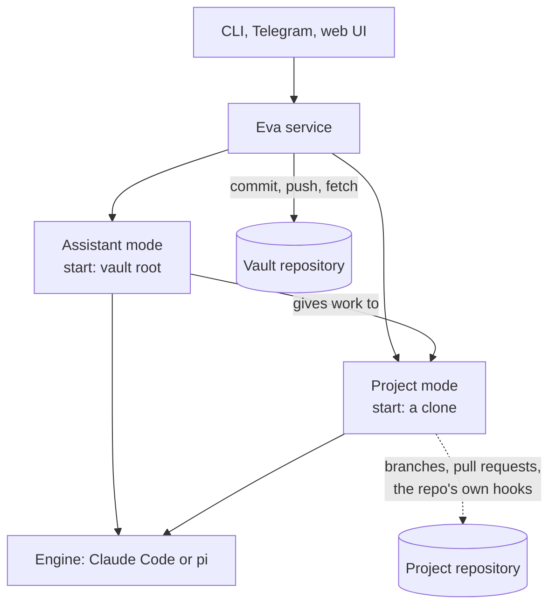

# Eva plan

Eva is a personal "super harness". She is one service that runs AI coding agents over a person's knowledge vault and projects, and she shows them in a terminal, Telegram, and a web app.

The name comes from EVE, the clever robot in the film WALL-E. Eva is the mind. A physical robot body can come one day, under its own name. Write `Eva` in prose and `eva` in identifiers. Eva takes the pronoun "she". The previous system is called Wall-I v1.

This plan says what Eva does and why. `intent.md` records what the owner wants. `lessons-from-v1.md` records what Wall-I v1 learned. `review-2026-10-14.md` records the review that shaped this version. The plan must satisfy all three. A claim marked **Spike** needs a small real test before the phase that depends on it.

Status: draft 2, 2026-10-14, after the review and the owner's answers.

## 1. Decisions

| # | Decision | Why |
|---|---|---|
| D1 | Two repositories: the public engine `guplem/eva`, and one private vault for each person (`guplem/vault`) | The vault autosaves to `main`. The engine needs pull requests and CI. Sharing needs an engine with no personal data. |
| D2 | The engine is developed as a public project from the first commit | Anybody can read it. No personal data, ever (§12). |
| D3 | Knowledge folders sit at the vault root | The vault holds only knowledge now. |
| D4 | A project is a folder `Projects/YYYY-MM-DD-HHmm-name/` with YAML front matter in its `AGENTS.md` | Ids never collide and show the order. One file serves people, machines and agents. |
| D5 | Cloned repositories live in `Projects/<project>/repos/<repo>-<n>/`, ignored by the vault's git | Each clone is one parallel workspace. |
| D6 | Eva is one service with three front ends: CLI, Telegram, web UI | Easy to run, lives on a Linux server, reachable from any device. |
| D7 | Eva owns vault sync inside her own code. Eva has no agent hooks, and the vault has no agent hooks | Each harness has its own hook system. Behaviour that Eva needs belongs to Eva. |
| D8 | Two modes. **Assistant mode** is Eva's own behaviour. **Project mode** is a transparent wrapper: it behaves exactly as opening the clone in the selected harness | The owner wants project work to be identical to opening the folder in Claude Code. |
| D9 | Claude Code is the main engine, connected directly through the Claude Agent SDK. pi is supported, connected directly. More engines come later | Claude Code is what the owner pays for, and a direct link keeps forks. pi is the fallback if the Claude subscription ends. |
| D10 | Remote access through Tailscale only | The web UI gives full shell access to the machine. |
| D11 | Any number of instances can run, under one OS user or several | Each instance has its own home folder, port, vault and engine logins. Isolation between instances is the user's responsibility. |
| D12 | TypeScript, run with Bun | One language for service and UI. The Agent SDK, pi and ACP ship TypeScript libraries. |

## 2. Repositories

### 2.1 Engine: `guplem/eva`

- The service source, tests, CI, and docs.
- The base assistant prompt (§5.2).
- A link to the vault template repository (§11).
- **Never** personal data: no vault content, no names of private people, no machine addresses, no employer names, no tokens.
- No merge ruleset for now. CI runs on every pull request and locally (§13).

### 2.2 Vault: `guplem/vault` (private)

```
vault/
  .eva/                   marks the vault root; Eva's vault-side files
    assistant.md          the person's assistant rules; Assistant mode only
    schedules.json        schedule definitions (lesson 64)
    skills/               assistant-only skills; Eva loads them in Assistant mode only
  AGENTS.md               the vault map: where each kind of note goes
  .agents/skills/         skills for every session in the vault, any mode
  .pskill/                programmatic skills: new-project, close-project, organize
  Principles/ Methods/ Toolbox/ Library/ Life/ _to sort/
  Projects/
    2025-03-02-1015-example-app/
      AGENTS.md           front matter (§3.2) + what an agent must know about the project
      ...notes...
      repos/              ignored by git (D5)
        example-app-0/
  Scratch/                ignored by git: files made only to send, files received
```

- **No `CLAUDE.md` anywhere in the vault.** A `CLAUDE.md` in a folder or above it stops Claude Code from reading `AGENTS.md` (lesson 112).
- **No `.claude/settings.json` with hooks in the vault.** Eva passes the settings she needs through the SDK (§7.2).
- **`AGENTS.md` at the root stays small and neutral:** a map of where things go. Personal rules go in `.eva/assistant.md`.
- **`.eva/skills/` sits outside the folders that engines search.** So assistant skills never reach a project session (lesson 5).

## 3. Projects

### 3.1 Folder name

`YYYY-MM-DD-HHmm-name`, for example `2025-03-02-1015-example-app`.

- **The timestamp is always the creation time,** to the minute. An idea gets a folder too, with `status: idea`, so the id never changes.
- **An unknown time gets the closest estimate,** found from every source: the Projects Sheet, the personal website repository, GitHub repository creation and first commits, local clones, the vault. The front matter records how precise the estimate is.
- **`name` is lowercase with hyphens.**
- **Nobody types the id.** The `new-project` pskill generates it.

### 3.2 Front matter

```yaml
---
created: 2025-03-02T10:15
created_precision: minute     # minute | day | month | year (estimate)
status: active                # idea | active | paused | closed
started: 2025-03-03           # optional
closed:                       # optional
objective: One sentence that says when the project is done.
deadline:                     # optional
repos:
  - https://github.com/owner/example-app
drive:                        # optional; created only when files must be shared
legacy_id: P93                # optional; matches the Drive folder "P## - Name"
tags: [work]
---
```

- **No `@` imports** (lesson 8).
- **A broken field never breaks the project list** (lesson 54).
- **A Drive folder is created only on request,** because Drive is for sharing files, not the main store.

### 3.3 Discovery

- **The vault root** is the nearest folder with `.eva/`.
- **Projects** are the folders under the vault's `Projects/` whose `AGENTS.md` has the front matter.
- **Extra project roots** can be added in the config.

### 3.4 Clones

- **`repos/<repo>-<n>/`,** where `<n>` counts from 0.
- **"New clone"** clones into the next free `<n>`. Eva also creates a clone by herself when a task needs a free one.
- **The vault's `.gitignore` holds `Projects/*/repos/`.**
- **Vault sync never enters a clone** (lesson 19).

### 3.5 Migration of existing projects (phase P1)

1. Inventory every project from the Projects Sheet (public CSV), the personal website repository, GitHub, local clones and the vault.
2. Estimate each creation time, merge duplicates, and keep `legacy_id`.
3. The owner confirms the list.
4. Create one folder for each project, move the existing notes, write the front matter.

After the migration, the Sheet is read-only history. Drive folders keep their `P## - Name` names for now.

## 4. The service

### 4.1 Responsibilities

| Area | What Eva does |
|---|---|
| **Vault sync** | Commit, push and fetch the vault (§6) |
| **Projects** | Find projects, read front matter, create clones, show the branch and pull request of each clone |
| **Sessions** | Start, resume, fork, retry and stop engine sessions; keep an index of them |
| **Skill runs** | Keep programmatic skill runs going without hooks (§5.4) |
| **Schedules** | Fire scheduled messages, on one machine only (§9) |
| **Front ends** | CLI, Telegram, web UI |
| **Tools** | Connect MCP servers, such as Google, to Assistant sessions |
| **Settings** | Store config and secrets in the instance home, test each one |

### 4.2 Parts

```
front ends:       CLI  |  Telegram  |  web UI
                          |
core:             sessions, projects, vault sync, schedules, skill runs, settings
                          |
engine adapters:  Claude Code  |  pi
```

- **A front end never names an engine** (v1 ADR `0003`).
- **One event vocabulary crosses the adapter boundary:** text, tool started, tool finished, history lost, notice, approval needed, turn finished, turn failed. Every stream ends with exactly one finish or fail event (lesson 47).
- **Architecture rules are checked by CI** (§13).

### 4.3 Instances

- **An instance is one Eva with one home folder:** config, secrets, session index, logs, and state.
- **The home folder is chosen** by `--home` or `EVA_HOME`. The default is the OS user's config folder.
- **Each instance gives its engines their own config folders:** `CLAUDE_CONFIG_DIR` for Claude Code, pi's agent folder, `GH_CONFIG_DIR` for `gh`. So two people on one OS user never share a login, and each person uses their own subscription.
- **Each instance has its own port.**
- **Isolation between instances is the user's responsibility.** A later feature can add forbidden paths.

### 4.4 Sessions, forks and retry

- **A session belongs to one mode, one engine, one model and one start folder.**
- **A fork starts a new branch from any earlier message.** The old branch stays.
- **A retry is a fork from the message before the answer.**
- **Claude Code:** the Agent SDK resumes a session up to a chosen message (`resumeSessionAt`) and forks it (`forkSession`). Eva sets the session id before the turn (`sessionId`, lesson 44).
- **pi:** tree sessions with fork and clone through RPC.
- **A message sent during a running turn waits,** and joins the next prompt (lesson 114).
- **First UI version:** a fork or retry shows as a new conversation under its parent. The branch graph comes later.

## 5. Modes

### 5.1 Overview



| | Assistant mode | Project mode |
|---|---|---|
| **What it is** | Eva's own behaviour | The harness, exactly as if opened on the clone |
| **Start folder** | Vault root | `Projects/<project>/repos/<repo>-<n>/` |
| **System prompt** | Engine default + Eva's base prompt + `.eva/assistant.md` | The engine default, unchanged |
| **Instructions** | Vault `AGENTS.md` and deeper ones | Whatever the harness loads by itself from that folder |
| **Skills** | Vault skills + `.eva/skills/` | Whatever the harness finds from that folder |
| **Hooks and project MCP** | None | The repository's own, after the trust step (§12) |
| **Commits** | Eva, automatically | The agent, on branches, with pull requests |

### 5.2 Assistant prompt

- **Eva's base prompt lives in the engine repository.** It says what every person needs: answer from the vault first, store lasting facts, ask before any action that other people see, how to send a file.
- **`.eva/assistant.md` lives in the vault.** It describes the person.
- **Claude Code:** Eva passes the `claude_code` preset with `append`, and `excludeDynamicSections: true` (lessons 39, 113). Without the preset, the SDK uses a minimal prompt.
- **The appended text is byte-identical on every turn** (lesson 40). The local time goes in the user message.
- **The prompt is fixed for a session until compaction.** An edit to `.eva/assistant.md` reaches new sessions at once, and running sessions after their next compaction (lesson 115).
- **The identity file is read for every new session.** A missing file fails the turn (lesson 11).
- **Spike S4** compares append with replace on 10 real requests, after daily use starts.

### 5.3 Assistant and projects

- **The assistant can read any project's notes and front matter.**
- **The assistant can give work to a project.** "Implement X in project Y" opens a Project mode session in a free clone of Y, or in a new clone. The assistant reports the result.
- **Project mode never works on the rest of the vault.**

### 5.4 Programmatic skills without hooks

pskill keeps a run going with a Stop hook: when the agent tries to stop while a step is open, the hook tells it to continue. Eva has no hooks (D7), so Eva calls the same pskill logic herself in Assistant mode. The owner approved this on 2026-10-14.

- **A run belongs to one session.** Since pskill 0.9.0, a run records the session that started or resumed it (Claude Code gives `CLAUDE_CODE_SESSION_ID` to each shell command). The stop check holds only that session.
- **After each Assistant turn,** Eva runs `uv run .pskill/pskill.py hook stop` in the vault, with the input `{"session_id": "<the session that just ended>", "cwd": "<vault root>"}`. That is the same command and the same input that the hook receives, so the pskill logic is reused, not copied: the session filter, the 3-attempt limit, the waits and the pause.
- **When pskill answers "block",** Eva sends its reason as the next message **of that same session**. When it answers "allow", the turn ends normally.
- **Eva always passes a session id.** pskill treats a check with no session id as a check for every session, so a missing id would continue another conversation's run.
- **A fork or retry is a new session.** A run continues in a fork only after the agent resumes it there (`pskill resume`), which moves its owner.
- **pi** needs a pskill harness entry for pi before this works with pi (P7).
- **Project mode is unchanged:** a project's own pskill hooks run as they always do.

## 6. Vault sync

- **Commit at the end of each Assistant turn.**
- **A timer sweep** (default every 5 minutes, configurable) commits, fetches, rebases and pushes. It never runs while a turn runs in the vault (lessons 22, 30).
- **Fetch before each Assistant turn.**
- **Push** only when `HEAD` has commits that the remote lacks. Retry fetch, rebase with `--autostash`, and push up to 3 times (lessons 23, 25).
- **Bound every git step with a timeout,** and clean up after a kill (lessons 24, 81). Set `GIT_TERMINAL_PROMPT=0` (lesson 100).
- **Only the default branch,** and only the configured vault path (lessons 18, 19).
- **A secret-pattern scan** runs before each commit. A file outside `Projects/*/` that matches stays out of the commit, and the owner is told. Secrets inside a project folder are allowed by the owner's vault rules. A scan never blocks the whole commit (lesson 27).
- **The state shows** in `eva status`, in Telegram `/status`, and in the UI.
- **Each machine with a vault clone runs an instance,** so manual edits there sync too.

## 7. Engines

### 7.1 Support (facts as of 2026-10-14)

| Engine | Connection | Subscriptions | Forks |
|---|---|---|---|
| **Claude Code** | Claude Agent SDK, using the user's own installed `claude` (absolute path, `pathToClaudeCodeExecutable`) | Claude Pro/Max for personal use, from the person's own login | Yes |
| **pi** | Child process, `pi --mode rpc` | ChatGPT Plus/Pro (official), GitHub Copilot; API keys for OpenRouter, OpenAI, Gemini and others | Yes |

- **Personal use of a Claude subscription through the Agent SDK draws from the plan's limits.** A product must not offer a claude.ai login to other people. Eva never offers one: each person logs in to their own `claude` program. **Spike S5** logs a real request to confirm what the program sends.
- **A Claude login inside pi bills as extra usage.** Do not use it.
- **Gemini consumer subscriptions** work only inside Google's own Antigravity tool since 2026-06-18. A Gemini API key works in pi.
- **ChatGPT subscriptions** work in open-source local apps through "Sign in with ChatGPT", since 2026-09-29.
- **Eva never embeds `claude`.** An embedded copy adds about 270 MB and breaks the update path (lessons 93, 94).

### 7.2 Engine settings

- **Settings list the engines,** each with a login step and a Test button that runs a tiny real prompt.
- **The model choice belongs to a conversation** and comes first in a new chat (lesson 41).
- **Each engine process gets an explicit allowlist of environment variables** (lesson 96).
- **Claude Code in Project mode** uses the same setting sources as an interactive session (`user`, `project`, `local`), so it behaves as opening the folder does.
- **Claude Code in Assistant mode** gets the setting `claude-md-and-agents-md`, and deny rules for the instance home and other secrets, through the SDK `settings` option (lesson 116).
- **pi** runs as a child process with a small Eva extension that blocks the same paths.
- **Claude Code on an unattended machine** uses `claude setup-token` (lesson 97).

### 7.3 Later

- **ACP** (Agent Client Protocol) for more engines, such as OpenCode or Codex. ACP has no standard fork yet.
- **A custom harness, marked beta.** It starts from pi's packages (`pi-ai`, `pi-agent-core`) and replaces pieces one at a time.

## 8. Front ends

### 8.1 CLI

- `eva` runs the service in the foreground.
- `eva setup` asks for each setting and writes the config file.
- `eva doctor` checks each prerequisite: `git`, `gh`, `claude`, `uv`, `ffmpeg`, typst, the transcriber. Each check shows how to install the missing tool.
- `eva status` shows engines, vault sync, sessions and versions.
- `eva chat` opens an Assistant conversation in the terminal.
- `eva service install` installs a systemd user service on Linux (lesson 85), or a logon task on Windows.

### 8.2 Telegram

Assistant mode front end, ported from v1 with lessons 56 to 63:

- Topics as conversations, with the model picker first in a new topic.
- Commands: `/new`, `/delete`, `/status`, `/schedules`, `/update`, `/help` (§15).
- Voice notes transcribed on the machine. Files sent from allowed folders, with offer buttons.
- One allowed chat id, set by a pairing code that the person sends to the bot.
- A request for project work opens a Project session and posts a link.

### 8.3 Web UI

Built from the mockups in `mockups/`:

- **Mode switch** at the top: Assistant, Project.
- **Project mode:** projects with their clones in the sidebar, a "New clone" button, the conversation of the selected clone, retry and fork buttons on each answer, the branch name and pull request number at the top. One input field for each branch.
- **Assistant mode:** schedules (with "Add schedule") and chats in the sidebar. Forks show as their own chats. A message that a schedule fired shows a clock icon. Retry and fork work here too.
- **Activity chips** under an answer ("3 commands, 2 turns", "2 background tasks") in both modes.
- **Settings:** sections Setup, Appearance, Projects. GitHub, vault repository, automatic fetch, Telegram, engines with login and Test, time zone, project roots.
- **Served on `localhost` only, and exposed with `tailscale serve`** (§12).

## 9. Assistant features

- **Google:** an MCP server for Calendar, Drive, Contacts and Tasks, for example `taylorwilsdon/google_workspace_mcp`. It is Python, so `uv` is a prerequisite. Pin its version (lesson 117). Start with read-only scopes.
- **Google login:** one Google Cloud OAuth client, set to "In production" so the login does not expire after 7 days. The owner's client can serve the partner too (up to 100 users while unverified).
- **Keep** has no API for personal accounts. Out of scope.
- **Schedules:** definitions in `.eva/schedules.json`. Only the instance with `schedules: true` fires them, which is the instance that runs Telegram (lesson 118). A new or changed schedule shows a setup card first (lesson 66). A configured time zone (lesson 68).
- **Voice:** `whisper.cpp`, plus `ffmpeg` to decode Telegram's Opus audio. **Spike S6.**
- **Files to send** come only from allowed folders, with the path resolved first (lesson 72). Scratch files older than a week are removed.
- **PDFs** through a typst binary.
- **Approval gate:** an action that other people see waits for a button press in Telegram or the web UI. Examples: a Google write, an issue, a push from Assistant mode. Claude Code: `canUseTool`. pi: an extension hook.

## 10. Phases

| Phase | Content | Done when |
|---|---|---|
| **P0** | Plan, intent, lessons, review | The owner approves this plan |
| **P1** | Vault restructure (§10.1) and project migration (§3.5) | The vault has the new layout, and the project folders exist |
| **P2** | Spikes S2, S3, S5 | Each spike has a written result, and the plan is updated |
| **P3** | Repository standard and CI (§13). Core: instances, config, vault sync, projects and clones, Claude Code adapter in both modes, sessions with fork and retry, skill runs. CLI | `eva chat` works in both modes, and the vault syncs |
| **P4** | Telegram | The owner uses Eva daily from the phone |
| **P5** | Web UI | Both modes and settings work from the phone through Tailscale |
| **P6** | Schedules, Google, voice (spike S6), files, PDFs, approval gate | The assistant reads and writes the calendar |
| **P7** | pi adapter, background task panel | A full conversation with a ChatGPT login and with OpenRouter |
| **P8** | Partner: her own instance on the shared Linux server. Vault template repository, guided setup, signed releases, single executable (spike S1) | The partner sets up her instance with the guide |
| **Later** | ACP engines, custom harness (beta), desktop window, forbidden paths, WhatsApp | |

The owner accepts that no remote assistant exists between P1 and P4.

### 10.1 P1 checklist

**Stage 0: before any change**
1. When the server laptop is on: stop and disable the v1 service, point its clone at `guplem/vault`, and push any notes it holds.
2. Commit and push the open note on this PC.
3. Disable the v1 `open-issue` skill. It names `guplem/Wall-I`, which now redirects to `guplem/eva`.
4. Run the v1 uninstaller while `walli/` still exists. It removes the Start Menu entry, the Windows Terminal profile and the `walli` command.
5. Tag the current `main` as `server-final` and push the tag.

**Stage 1: restructure on a branch**
6. Work on a branch with a conventional prefix, which the v1 sync hooks ignore.
7. `git mv` the knowledge from `walli/Knowledge/` to the root, `_to sort/` included.
8. Rewrite every path reference: `Knowledge/`, `Scratch/`, `ASSISTANT.md`, `schedules.json`, the typst command, and project ids (lesson 13). Wiki-links need nothing.
9. Move `walli/ASSISTANT.md` to `.eva/assistant.md`, `walli/schedules.json` to `.eva/schedules.json`, and the assistant skills to `.eva/skills/`.
10. Write the new small root `AGENTS.md` from `walli/AGENTS.md`.
11. Delete the v1 code and machinery: `server/`, `adr/`, `.claude/agents/`, the server workflow, the server hooks, the launchers and installers, the `CLAUDE.md` shims.
12. Keep only the v1 sync hooks, adapted to the root layout, as **temporary** files until Eva syncs (P3).
13. Update `.gitignore`: `Scratch/`, `Projects/*/repos/`, `.env`, `*.pem`, `*.key`, `settings.local.json`.
14. Migrate the projects (§3.5).
15. Merge to `main`, push once, and check that a Claude Code session at the root pulls and pushes.

**Stage 2: GitHub**
16. Delete old branches. Move issues #10 and #59 to `guplem/eva` without personal content, or close them.

**Rollback:** a forward commit that restores `server-final`, never a force-push.

## 11. Sharing with the partner

- **Same setup as the owner:** a Windows laptop, an Android phone, and an instance on the owner's Linux server.
- **Her own instance:** her own home folder, port, vault, bot, and engine logins (§4.3). Same OS user or her own, as she prefers.
- **Her own Claude subscription,** through her own `claude` login in her instance's own config folder (§4.3).
- **Tailscale:** her phone and laptop join the owner's tailnet. Each instance accepts only the Tailscale identities in its config.
- **Vault creation:** a GitHub login by device flow (enter a code on a web page), then a private vault created from a separate template repository.
- **Google:** she logs in with the owner's OAuth client.
- **Setup by guide:** `eva setup` in order: doctor, vault, engine, Telegram (pairing code), Google, time zone, a few questions that write her `.eva/assistant.md`.
- **Nothing personal is hardcoded in the engine.** v1 hardcoded the owner's name, `guplem/Wall-I` and `~/Wall-I`.

## 12. Security model

- **An instance is full shell access as its OS user.** Whoever controls a front end controls the machine.
- **Telegram:** one allowed chat id (lesson 63). Telegram two-factor login is recommended.
- **Web UI:** listens on `localhost` only, published with `tailscale serve`. Eva checks the Tailscale identity header against the instance's allowlist, checks `Host` and `Origin` on every request and WebSocket, and never falls back to `0.0.0.0`. Never Tailscale Funnel, never a public tunnel.
- **Project trust:** the first time a clone is opened, Eva asks whether to trust it, as Claude Code does. A clone from a repository owner on the allowlist (default: the owner's GitHub account) is trusted by default. An untrusted clone runs with its hooks and project MCP servers off.
- **Secrets** live in the instance home, readable by its OS user only. Logs and the event stream are redacted (lesson 95). An agent can still read any file through a shell. The real protection is the env allowlist, redaction, and secrets outside the vault where possible (lesson 116).
- **GitHub credentials:** a deploy key for the vault. A fine-grained token for project pull requests, scoped to project repositories. The engine repository is in neither (lesson 119).
- **Google data is untrusted input.** Read-only scopes first. Outward actions go through the approval gate (§9).
- **MCP servers and skills** run pinned versions.
- **Releases** come only from CI on tags, and self-update checks a signature.
- **A schedule is a second way in** (lesson 67). The setup card stays.
- **Issues that Eva files** go to the person's private repository, never to `guplem/eva`.
- **The engine repository is public.** Docs and examples use neutral data.

## 13. Development standard

The engine is built mostly by AI agents ("vibe coding"). The repository must keep the code consistent by itself.

- **Red-green TDD** for every behaviour change: a failing test first, then the code.
- **Strict TypeScript.** No `any`.
- **Linting and formatting** with fixed rules, run in CI and before each push.
- **Architecture checks in CI:** a dependency rule tool (for example `dependency-cruiser`) enforces the layers of §4.2. Front ends never import adapters. Adapters never import front ends. The core imports neither.
- **Pattern checks:** each pattern has one written standard and a check where a check is possible, for example file naming, the event vocabulary, error types.
- **Coverage:** 90% lines and branches as the floor (lesson 103).
- **Useful tests:** mutation testing (for example Stryker) on the core and the adapters, with a minimum score. A test that no mutation can fail is noise.
- **Engine adapters:** tests with captured real output, and contract tests for the arguments (lesson 101). Fakes only at the named seams (lesson 102).
- **CI runs on every pull request.** The same checks run locally. No merge ruleset for now.
- **Setup:** P3 starts with the owner's repository standard (the `setup-guplem-standard` skill), adapted to these rules.

## 14. Spikes

| Spike | Question | Before |
|---|---|---|
| **S1** | Does Eva build into a single executable with `bun build --compile` on Windows and Linux, with the SDK pointing at an external `claude`? | P8 |
| **S2** | Do `resumeSessionAt` and `forkSession` fork at any message? Does a fork keep the prompt cache? Do Assistant turns hit the cache? | P3 |
| **S3** | In a clone: does Claude Code through the SDK load exactly what an interactive session loads? With a `CLAUDE.md` in the clone? Do `.eva/skills/` stay out of Project sessions? | P3 |
| **S4** | Append or replace the system prompt in Assistant mode, on 10 real requests | After P4 |
| **S5** | On a subscription login, what does the SDK send (identity line, limits)? Log a real request. | P3 |
| **S6** | `whisper.cpp` with a real Telegram voice note (Opus) on Windows and Linux | P6 |

## 15. Wall-I v1 features

| v1 feature | In Eva | Reason |
|---|---|---|
| Telegram topics, model picker, `/new`, `/delete` | Port (P4) | Core of daily use |
| `/status` with versions, cache numbers, sync state | Port (P4) | Lesson 94 |
| `/update`, `/update engine` | Replace: self-update with signature (P8), engine update in settings | Single executable |
| `/schedules`, setup cards | Port (P6) | Lessons 64 to 70 |
| Voice transcription | Port with `whisper.cpp` (P6) | Lesson 71 |
| File markers, offer buttons, received files in Scratch, weekly cleanup | Port (P6) | Lessons 72 to 74 |
| PDF making | Port with a typst binary (P6) | Lesson 75 |
| `update-walli`, `schedule`, `open-issue` skills | Port to `.eva/skills/`, renamed; `open-issue` targets the private repository | Lesson 17, §12 |
| `be-walli` launchers, installers, shortcuts, Terminal profile | Replace with `eva chat` and `eva service install` | One program |
| `bootstrap.sh`, `update.sh` over SSH, machine guides | Replace with `eva setup` and `eva doctor`; keep a machine guide outside the public repo | No personal data in the engine |
| Sync hooks | Replace with Eva's own sync (§6) | D7 |
| Development skills for the server code | Replace with the new repository standard (§13) | New code base |

## 16. Open questions

1. **Vault conflicts:** how Eva shows a rebase conflict when two machines change the same note.
2. **Session index:** kept per machine in the instance home (proposed), or synced.

Answered on 2026-10-14: skill runs without hooks (§5.4, approved), and the partner's subscription (Claude, so P8 does not wait for pi).
